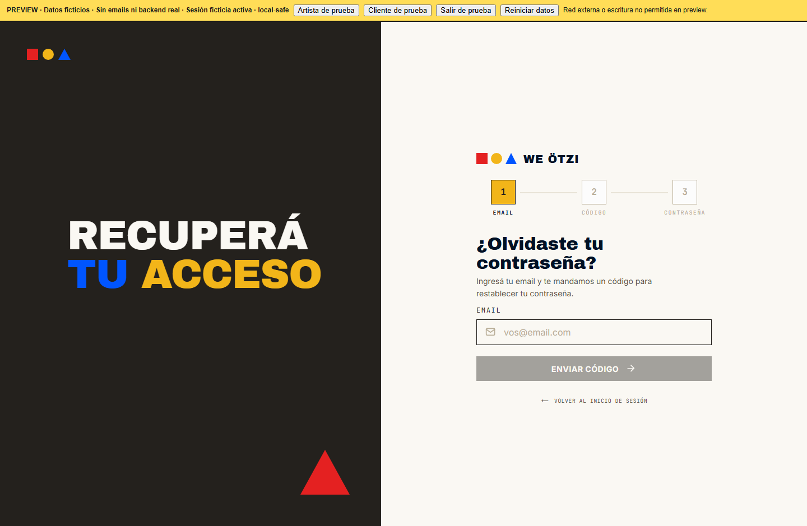
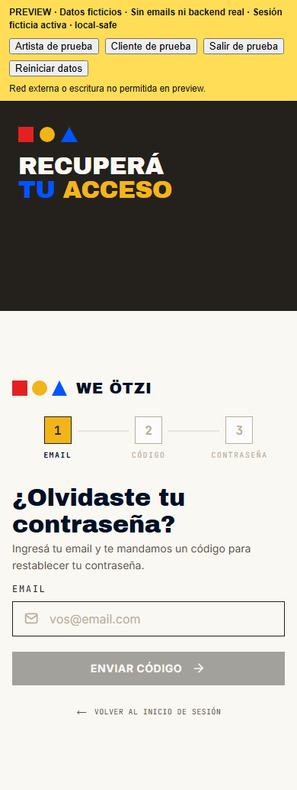
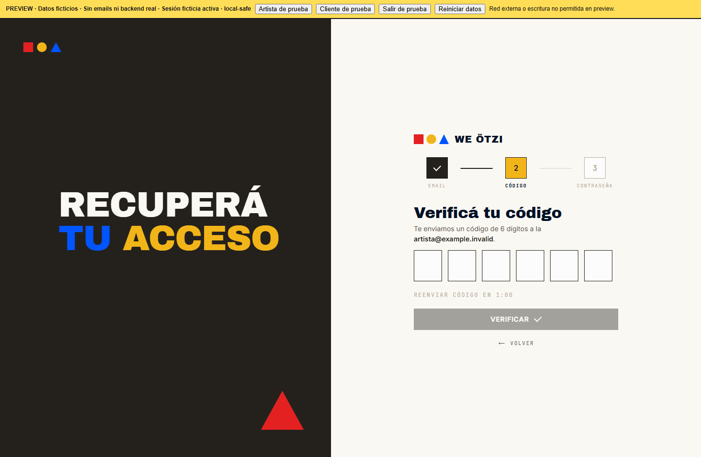
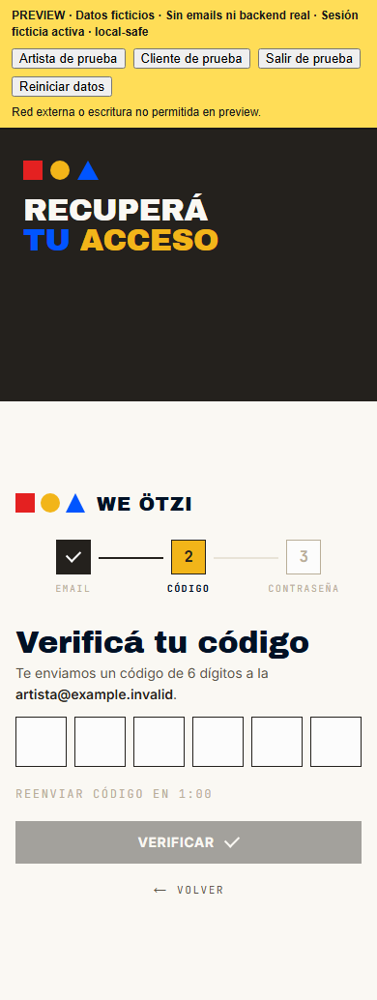
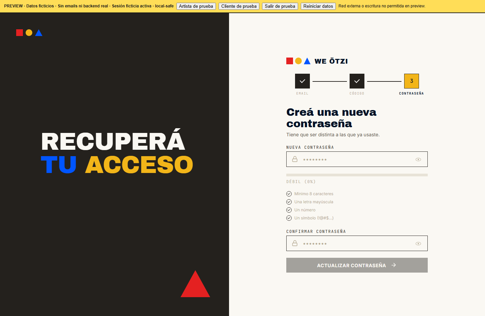
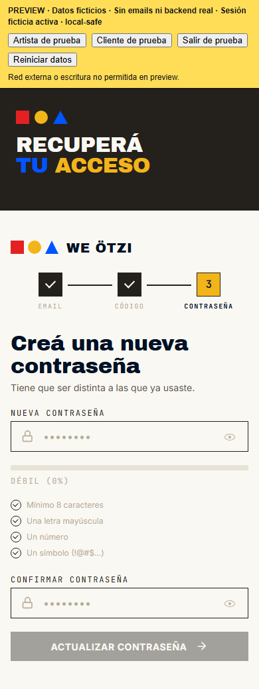
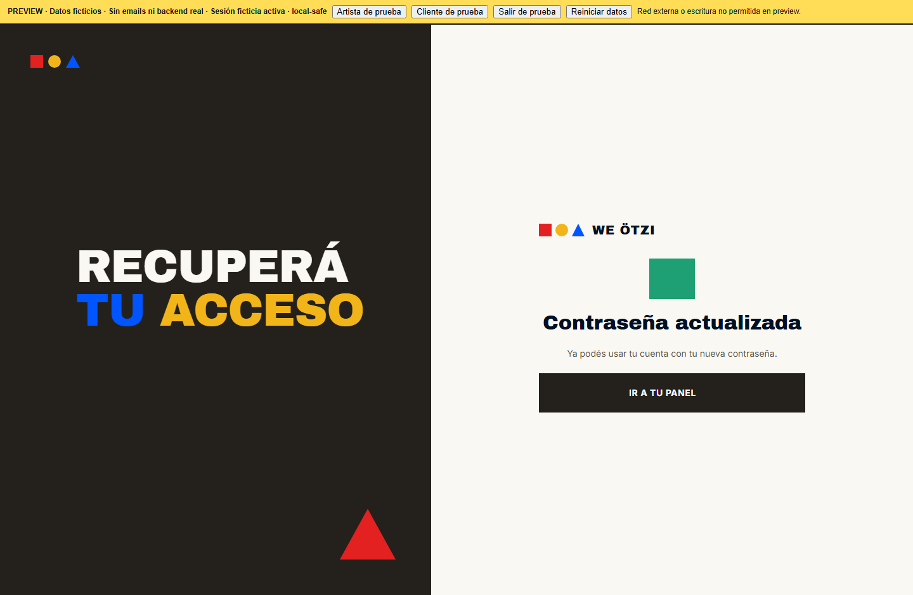
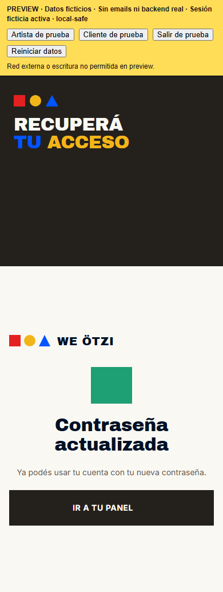

# Recuperar contraseña · artista · galería de los cuatro pasos

Capturas de `/recover?from=artist` en `preview-local-safe`, tomadas del código de la rama en `1377e80`, con Chrome aislado a **1440 × 900** y **390 × 900**. La altura de página incluye la barra amarilla PREVIEW. Para mostrar cada vista sin enviar correos, verificar OTP ni actualizar una contraseña, se alternó **solo el DOM de esa sesión de captura**. El único correo mostrado es `artista@example.invalid`; los campos de contraseña están vacíos. Las imágenes muestran composición, **no** una recuperación completada ni persistencia real.

El **paso 4 es el estado actual pendiente de rediseño** y no debe confundirse con una implementación aprobada del nodo Figma. En la preview sin CDN, el icono de check de la tarjeta verde aún no se ve; se revisará con el paso 4.

## Paso 1 · Email

**Desktop**

**Celular**

## Paso 2 · Código

**Desktop**

**Celular**

## Paso 3 · Nueva contraseña

**Desktop**

**Celular**

## Paso 4 · Éxito actual (pendiente de rediseño)

**Desktop**

**Celular**

