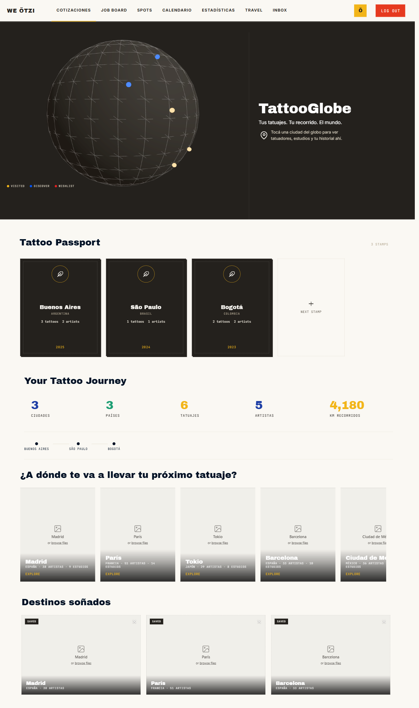
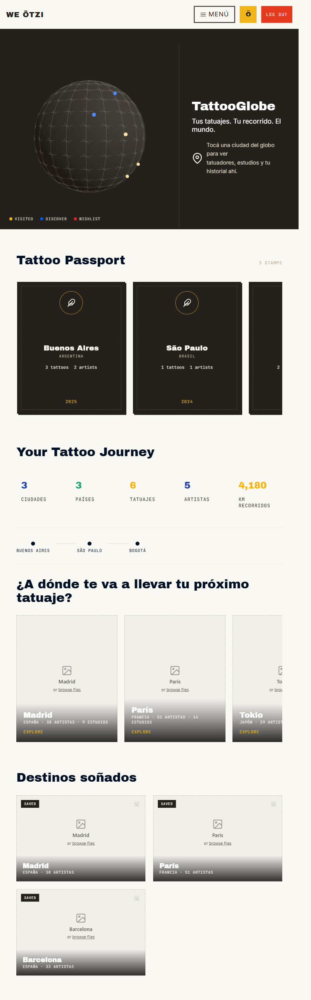
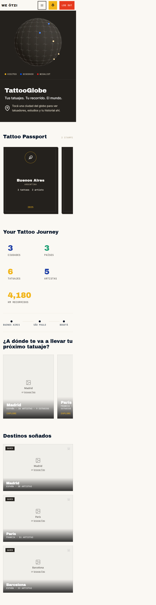

# Pantalla 11 · TattooGlobe

Este documento registra la entrega inicial `.20`. La [ampliación `.21`: detalle de destino Lisboa](destino-lisboa.md) agrega la ficha intermedia antes del atlas, conservando esta composición inicial.

## Alcance y referencia

- Frame final: [801:1146](https://www.figma.com/design/w3JA83CcP5ISKjyOu87mx1/We-Otzi-Pantallas-final?node-id=801-1146), 1440 × 2445.
- Sistema de diseño consultado: `jLxPQyG2rxrq5bvfQgNcBd`; se reutilizan tokens, navegación `weotzi-product-nav`, iconos y fuentes locales existentes.
- Ruta única: `/explore/globe/`. No se editan otras pantallas, CSS global, componentes compartidos, servidor ni esquemas de datos.
- Rama: `valentina/rediseno-laura`. Versión: `2.2.3-valentina.rediseno-laura.20`.
- Local seguro: `http://localhost:4648/preview/preview-local-safe/explore/globe/`. El puerto 4647 estaba ocupado por otro proceso que servía contenido distinto del checkout; no se detuvo ni se accedió a su carpeta. Se usó el mismo lanzador seguro con `startLocalPreview({port:4648})`.
- Entrega: [preview pública](https://preview.weotzi.chat/explore/globe/). La SHA publicada debe verificarse contra `/api/release` y el CI de esta entrega.

## Inventario

| ID | Rol / URL / estado | Referencia | Visual | Funcional | Evidencia |
| --- | --- | --- | --- | --- | --- |
| P11-01 | Cliente · `/explore/globe/` · composición inicial | 801:1146 | Coincide | Simulado | Captura desktop, fuentes e imágenes locales cargadas |
| P11-02 | Pasaporte, recorrido y cifras del frame | 332:717 / 332:792 | Coincide | Simulado | Tres sellos y valores literales solo en preview |
| P11-03 | Destinos y destinos soñados | 332:840 / 332:988 | Coincide | Probado | Abrir ciudad, vacío, quitar, recargar y eliminar los tres |
| P11-04 | Atlas existente · filtros / selección / detalle | Fuera del estado estático del frame | Falta referencia | Simulado | Conserva el atlas COBE y el directorio existentes dentro de un diálogo |
| P11-05 | Escritorio adaptable, tablet y móvil | Solo hay referencia desktop | Coincide | Probado | Sin overflow de página/cabecera/estadísticas en nueve anchos |
| P11-06 | Historial real del pasaporte de cliente | No hay contrato de datos implementado | Falta referencia | Bloqueado | Se muestra indisponibilidad, nunca ejemplos como historial real |

## Comparación y recursos

Los nueve SVG originales y la imagen del globo se descargaron desde Figma y viven en `public/shared/assets/tattoo-globe/`. La captura de referencia no se usa como imagen de implementación. Los destinos vacíos, incluido el texto `or browse files`, son literales del frame, no fotografías faltantes ni controles de carga del producto.

Mediciones del render de 1440 px (coordenadas CSS; diferencias inferiores a 1 px por rasterización):

| Elemento | Figma | Navegador |
| --- | --- | --- |
| Globo | 851 × 593, x 0, y 95,5 | 851 × 593, x 0, y 95,33 |
| Tattoo Passport | x 68, y 818 | x 67,99, y 817,99 |
| Your Tattoo Journey | x 84, y 1302 | x 83,99, y 1301,98 |
| Próximo tatuaje | x 70, y 1628 | x 70, y 1627,71 |
| Destinos soñados | x 75, y 2070 | x 74,99, y 2069,70 |

Se verificaron `complete`, dimensiones naturales no vacías, callsites y geometría de cada recurso visible. Los SVG mantienen sus medidas raíz; las partes del pin, pluma y signo más se componen sin redibujarlos. Archivo Black, Inter y JetBrains Mono se sirven desde los TTF locales existentes.

## Pruebas de navegador

Browser integrado disponible. Los primeros intentos de captura/clic fallaron por una pestaña no visible. Valentina dejó visible Review y se continuó con Browser, sin fallback a otro navegador.

El flujo probado es: `/explore/globe/` → globo o ciudad → atlas filtrado → artista → detalle / cotización; adicionalmente navegación, Next stamp y destinos soñados.

| Comprobación | Resultado |
| --- | --- |
| Identidad de página y contenido significativo | Aprobado: título TattooGlobe y cuatro secciones del frame |
| Sin overlay de error ni página vacía | Aprobado |
| Consola del render final | Sin errores JavaScript; aviso esperado de soporte 501 en preview, previo a esta tarea |
| Capturas | Desktop, 768 y 390 px revisados |
| Anchos CSS | 1920, 1600, 1440, 1366, 1280, 1200, 1024, 768 y 390; sin overflow horizontal de página, header ni estadísticas |
| Menú compacto | Abre, Escape cierra y devuelve foco al botón |
| Globo | Abre atlas y carga el directorio ficticio existente; WebGL disponible en esta prueba |
| Ciudad Madrid | Filtra a Madrid y muestra ausencia de artistas en el directorio de prueba, sin falsificar resultados |
| Limpiar filtros | Recupera el directorio y el título general; corregida la etiqueta de ciudad que quedaba obsoleta |
| Artista → detalle | Abre la ficha ficticia dentro del atlas; Escape cierra solo la ficha y devuelve foco a Ver detalle |
| Artista → Cotizar | Llega a `/quotation/?artist=valentina-preview.wo`; no se envía ninguna solicitud |
| Next stamp | Desplaza al descubrimiento y mueve el foco al título de destino |
| Quitar destino | Quita Madrid, conserva París/Barcelona y persiste tras recarga en este navegador |
| Todos los destinos quitados | Estado vacío visible y foco conservado; solo se restauró la clave local creada en esta prueba |
| Log out | Cierra sesión ficticia y llega a `/client/login/`; no acredita autenticación real |

Para controlar anchos exactos con Browser se montó la misma página en un iframe de QA del mismo origen. El viewport interior, las media queries y las medidas CSS fueron reales; las capturas de Review se escalan para mostrar la página completa. El arnés de QA no forma parte del producto. No se afirma emulación de un dispositivo físico.

## Datos, límites y aislamiento

- No se cambian RLS, Auth, consultas de artista/itinerario, destinos de cotización ni IDs. El directorio conserva `Artists.listWithLocation` / `listForMap`, y el itinerario conserva sus repositorios existentes.
- Los sellos Buenos Aires / São Paulo / Bogotá, las métricas y los conteos de ciudades del frame se usan únicamente cuando el adaptador seguro identifica `WEOTZI_PREVIEW === true`.
- No existe todavía un repositorio del pasaporte de **cliente**: no se reutiliza el pasaporte de viajes del **artista**, ni se infiere dónde se realizó un tatuaje a partir de su residencia. En runtime normal se informa que el historial no está disponible y las estadísticas son `—`.
- Los conteos normales de destinos derivan del directorio, no de ejemplos. Quitar destinos se guarda únicamente en el navegador, por identidad y release de preview; no se promete sincronización remota.
- El frame muestra cifras editoriales de destinos (por ejemplo, Madrid: 38 artistas), pero el adaptador seguro solo tiene un artista en Buenos Aires. Abrir Madrid muestra el vacío verdadero del adaptador, no 38 artistas inventados.
- Integraciones, correos, escritura Supabase, historial y seguridad de sesiones reales no fueron probados ni modificados. El soporte remoto 501 está bloqueado por el adaptador seguro.
- CSS de esta tarea solo se carga en `/explore/globe/`; `explore-globe.js` también es exclusivo de esta ruta. No se modificaron las otras pantallas.

## Automatización y recuperación

- TDD del modelo: cuatro pruebas inicialmente fallidas y después aprobadas (separación preview/runtime, conteos reales, comparación de ciudades y almacenamiento corrupto/vacío).
- `npm test`: 445 pruebas aprobadas. `node --check` de los módulos modificados y `git diff --check`: aprobados.
- `npm run check:release` y repetición de la suite se ejecutan en la entrega automática antes de commit/push. La publicación solo se considera terminada con CI y la misma SHA en `/api/release`.
- Recuperación: revertir el commit de esta entrega mediante una entrega versionada. No hay migraciones ni cambios remotos de datos que revertir. La versión anterior es `.19`, SHA `c63b3d28f872f41c609d7d139094b18ff1d2930b`; el rollback operativo corresponde a Isaí.

## Capturas

