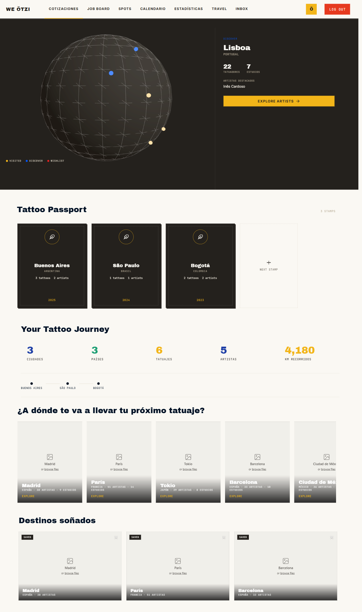
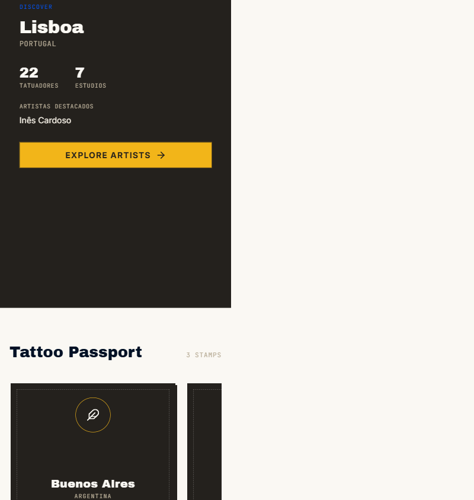

# Pantalla 11 · Detalle del destino Lisboa

## Referencia y decisión aprobada

- [Frame 801:1153](https://www.figma.com/design/w3JA83CcP5ISKjyOu87mx1/We-Otzi-Pantallas-final?node-id=801-1153), componente de 512 × 551,8 en la página `Flujo clientes`.
- La inspección de solo lectura confirmó que es hermano del frame `801:1146`, no un hijo suyo. Los dos componentes y sus descendientes no tienen conexiones de prototipo.
- Por nombre, borde lateral y composición corresponde a la ficha de destino del panel derecho. Valentina aprobó integrarla como paso intermedio: selección → ficha → Explore Artists → atlas filtrado, conservando el resto de la pantalla.
- El punto azul superior del globo ilustrado abre Lisboa **solo en preview**. Este disparador es una decisión de implementación aprobada, no una conexión ni coordenada geográfica especificada por Figma. Las tarjetas de destinos y guardados abren la misma ficha para su ciudad.
- Versión `2.2.3-valentina.rediseno-laura.21`; rama `valentina/rediseno-laura`. Ruta única: `/explore/globe/`.

## Implementación y aislamiento

Se mantienen el HTML/CSS/JavaScript existente, fuentes locales, tokens y encabezado compartido. Se agrega la flecha original `explore-arrow.svg` (18 × 18) y la ficha dentro del hero. No se cambian otras pantallas, el DS global, el atlas ni los repositorios compartidos.

La vista inicial conserva exactamente las mediciones de `.20`: globo 851 × 593 en `(0;95,33)`, título `(897,46;349,43)`, pasaporte `(67,99;817,99)`, recorrido `(83,99;1301,98)`, descubrimiento `(70;1627,71)` y destinos soñados `(74,99;2069,70)`, con viewport CSS 1440 px.

La ficha hereda el fondo del hero: el componente de Figma no declara un fondo propio en el contexto de diseño. Textos y contenido internos siguen el fragmento literal. Coordenadas relativas al panel derecho a 1440 px:

| Elemento | Figma | Render |
| --- | --- | --- |
| Discover | x 32,8; y 36,8 | x 33,46; y 36,79 |
| Lisboa | y 61,2; alto 33 | y 61,19; alto 33 |
| Portugal | y 98,2; alto 16 | y 98,19; alto 16 |
| Métricas | y 138,2 | y 138,19 |
| Explore Artists | y 271,8; 447,2 × 44 | y 271,79; 447,20 × 44 |
| Flecha | 18 × 18 | 18 × 18 |

La diferencia horizontal inferior a 1 px corresponde a la cuantización del borde de 0,8 px en el navegador. No se estira ni redibuja el SVG.

## Datos

- El ejemplo Lisboa / Portugal / 22 tatuadores / 7 estudios / Inês Cardoso existe únicamente bajo `WEOTZI_PREVIEW === true`.
- En runtime normal se usan `Artists.listWithLocation` y el fallback `listForMap`, ampliando su proyección pública a `user_id,city,country,studio_id,name,username,is_recommended`. Se cuentan artistas únicos por `user_id`, estudios únicos por `studio_id` y destacados con `is_recommended`; no se insertan registros ni se alteran permisos.
- Cambiar a Madrid no conserva el nombre Inês ni los números de Lisboa. En preview mantiene las cifras editoriales de Madrid del frame inicial; un destacado inexistente se informa como tal.
- El adaptador seguro no tiene artistas en Lisboa. Explore Artists muestra el vacío real de ese directorio, no 22 filas inventadas. El filtro, selección de artista y destinos de cotización siguen a cargo del atlas existente.
- La ficha no modifica el historial ni guardados; recargar vuelve a la introducción. El límite previo del pasaporte real de cliente se mantiene.

## QA

Entorno: Browser integrado, local seguro en `http://localhost:4648/preview/preview-local-safe/explore/globe/`. Se reutilizó el lanzador seguro de la entrega anterior, sin tocar el proceso ajeno del puerto 4647. Los anchos exactos se comprobaron con un iframe del mismo origen dentro de Review; el arnés de QA no se publica.

| ID | Estado / recorrido | Visual | Funcional | Evidencia |
| --- | --- | --- | --- | --- |
| P11-L01 | Introducción antes de elegir | Coincide | Probado | Geometría idéntica a `.20` |
| P11-L02 | Punto azul → Lisboa | Coincide | Simulado | Texto literal y SVG original; atlas aún cerrado |
| P11-L03 | Lisboa → Explore Artists | Coincide | Simulado | Atlas abierto, filtro Lisboa, cero resultados reales del adaptador |
| P11-L04 | Escape del atlas y de la ficha | Coincide | Probado | Primero conserva la ficha y su CTA; luego restaura introducción y foco visible en el globo |
| P11-L05 | Tab / Enter sobre punto | Coincide | Probado | Selección y foco en el título Lisboa |
| P11-L06 | Tarjeta Madrid después de Lisboa | Coincide | Simulado | Madrid, 38/9, sin nombre filtrado desde la otra ciudad |
| P11-L07 | 390–1920 px | Coincide | Probado | Nueve anchos sin overflow de página, ficha ni botón |
| P11-L08 | Directorio y autenticación remotos | Falta referencia | No probado | Sin cuentas reales ni pruebas remotas autorizadas |

Se revisaron los anchos 1920, 1600, 1440, 1366, 1280, 1200, 1024, 768 y 390. Se reprodujo un desborde de 512 px al seleccionar en móvil: el ancho preferido del fragmento imponía el mínimo de la columna Grid. Se corrigió con `minmax(0,1fr)`, sin ocultar el problema con clipping. Botón de 44 px y flecha de 18 × 18 en todos los anchos. En móvil se desplaza a la ficha para mostrar la acción, y al volver se devuelve el foco al globo dentro del área visible.

Página con título y contenido significativo, sin overlay de error. Todos los recursos visibles y fuentes locales cargados. Consola sin errores propios; el soporte remoto 501 sigue siendo una limitación previa de preview.

TDD: tres pruebas nuevas primero fallidas y después aprobadas para datos de Lisboa solo en preview, agregación de datos reales y cambio de ciudad sin contaminación. `npm test`: 448/448 aprobadas. `node --check` y `git diff --check` se revisan junto a la entrega. `check:release` y repetición de suite se ejecutan antes de commit/push; la publicación solo se confirma con CI y misma SHA/version pública.

## Recuperación y evidencia

Revertir el commit de esta ampliación mediante una nueva entrega versionada. No hay migraciones ni escrituras remotas que revertir. Versión anterior `.20`: `79628d8f468109d26bedd404eba65459cf58ab63`. Isaí conserva el control del rollback operativo y merge a main.

