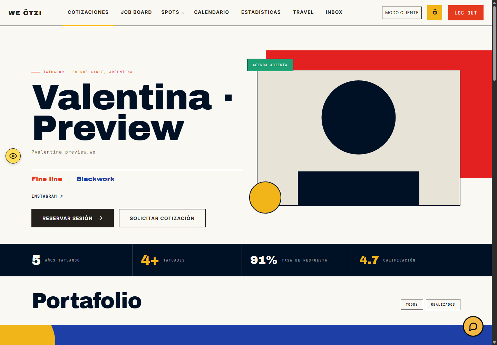
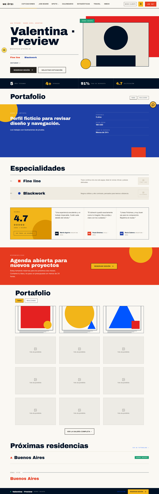
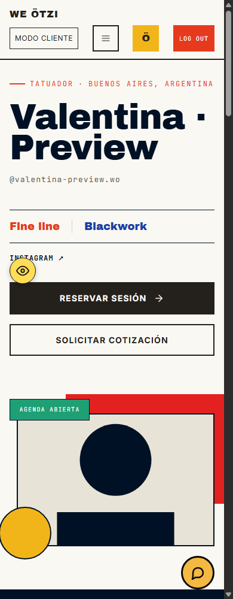

# Pantalla 9 · Perfil público del artista

## Alcance y referencia

- Rama: `valentina/rediseno-laura`.
- Versión: `2.2.3-valentina.rediseno-laura.17`.
- Figma: [frame 801:1155](https://www.figma.com/design/w3JA83CcP5ISKjyOu87mx1/We-Otzi-Pantallas-final?node-id=801-1155), leído mediante `get_design_context`, código de referencia completo y captura.
- Sistema de diseño: [We Ötzi](https://www.figma.com/design/jLxPQyG2rxrq5bvfQgNcBd/Design-System-We-Otzi?node-id=11-782), biblioteca y tokens existentes. Se reutilizan `weotzi-product-nav`, fuentes, colores y Feather; no se modifica el organismo compartido.
- Ruta: `/artist/profile/?artist=<username>`, desde la tarjeta de artista de `/marketplace/`.
- Local seguro: `http://localhost:4689/preview/preview-local-safe/`. Los puertos 4647 y 4648 estaban ocupados; 4647 servía otra copia temporal. No se cerraron esos procesos.
- La usuaria confirmó conservar las imágenes y los datos del artista en los espacios del frame. No se fuerza el ejemplo Sofía Rossi ni sus cifras sobre otros perfiles.

## Trazabilidad

`marketplace.js` → `data-card-href` → `public/artist/profile/index.html` → `artist-profile.js` y `artist-profile-presentation.js` → repositorios de artistas/estudios y consultas públicas existentes.

Cambios de runtime únicamente en `public/shared/css/artist-profile.css`, la composición del portafolio en `public/shared/js/artist-profile.js` y un SVG local. No se alteran consultas, permisos, autenticación, reseñas, destinos de CTA ni otros documentos HTML. La galería independiente también carga la hoja CSS, pero no utiliza los selectores modificados; sus estilos y controladores no cambian.

## Comparación visual

| Elemento | Antes | Corrección / resultado |
| --- | --- | --- |
| Hero | Columna izquierda fija de 660 px, nombre con tracking diferente y estilos demasiado grandes | Reparto 1,05/0,95, nombre 104 px / 0,86 / −2%, estilos 19 px y bloque rojo al 54% de la sección |
| CTA principal | Texto azul por precedencia del enlace global | Fondo oscuro y texto crema, altura 52 px, sin cambiar destino |
| Introducción del portafolio | Margen posterior de `.gallery-chips` alteraba la altura | Altura de referencia 140,65 px y filtros sin margen heredado |
| Biografía | Texto limitado a 690 px, derecha demasiado angosta | Columnas 1,5/1, separación 56 px, titular 40 px / 1,14 y texto 16 px / 1,7 |
| Especialidades | Miniaturas 116×66 y columnas de ancho mínimo rígido | Miniaturas 96×64, distribución flexible, tipografía 34 px y separación de 24 px |
| Reseñas | Panel fijo de 374 px y avatares circulares | Proporción 0,85/2, fondo crema y avatares cuadrados como el frame |
| Disponibilidad | Flex y padding derecho de 240 px | Grid 1,3/1 con separación de 48 px; CTA amarillo y texto de datos existente |
| Portafolio | Nueve espacios y una ilustración genérica en vacíos | Doce espacios, icono original local de Figma y título del espacio vacío; fotos del artista intactas |
| Encabezado angosto | Salida horizontal en 1280 y 390 px | Menú en escritorio angosto y segunda fila en móvil, con selectores limitados a este perfil |

El frame incluye controles de edición de imágenes (`browse files`, `Replace`, `Edit`) en sus espacios vacíos. No se convierten en cargas de fotos para un cliente visitante: se conserva el espacio y su icono, sin inventar permisos de edición. El portafolio vacío no muestra el botón de galería completa ni abre lightbox.

## Inventario

| ID | Rol / URL / estado | Referencia | Visual | Funcional | Evidencia |
| --- | --- | --- | --- | --- | --- |
| P9-01 | Visitante/cliente · perfil cargado | 801:1155 | Coincide en composición; contenido dinámico confirmado | Simulado | Captura desktop y mediciones en seis anchos |
| P9-02 | Portafolio parcial y vacío | 801:1155, espacios de imagen | Coincide en grilla; sin controles de edición ajenos al rol | Simulado | Doce espacios, tres trabajos ficticios; vacío sin acción de galería |
| P9-03 | Menú, filtros, lightbox y reseñas | Sin variante específica en el nodo | Falta referencia para estados abiertos | Probado en preview | Abrir, siguiente, Escape y estado sincronizado |
| P9-04 | Artista inexistente | Sin referencia en el nodo | Falta referencia | Probado en preview | Perfil oculto, mensaje de no encontrado y regreso al marketplace |
| P9-05 | Estudio / meses / idiomas / verificación opcionales | 801:1155 | Con desvíos por ausencia de esos datos en el fixture | No probado con datos completos | Se conserva el render condicional, sin inventar estudio ni disponibilidad |

## Pruebas

1. Se reprodujeron primero aserciones fallidas: color del botón, proporción de biografía, grid del CTA, altura de introducción, nueve espacios y geometría del placeholder. Después del cambio, todas pasan.
2. Chromium real con viewports 1920, 1440, 1280, 1024, 768 y 390 px. Ninguno tiene scroll horizontal. Imagen vacía de Figma: 28×29,09375 px renderizados (atributo original 28×29,1); los tres trabajos ficticios se cargan después de desplazar a la galería.
3. Navegador integrado: modo cliente de prueba → marketplace → tarjeta → perfil correcto. Identidad de página y contenido no vacío comprobados, sin overlay de framework.
4. Menú abre y cierra con Escape. Lightbox abre trabajo 1, siguiente muestra `2 / 3`, Escape cierra. Filtros superiores e inferiores sincronizan `aria-pressed`. Reseñas expande el widget existente.
5. Reservar mantiene `artist=valentina-preview.wo` al abrir `/quotation`. Solicitar cotización conserva `/quotations`, cuyo alias existente redirige a `/quotation` con el mismo parámetro. No se modifica ese contrato.
6. Portafolio vacío ensayado solo en memoria del fixture y restaurado: cero trabajos reales, doce espacios, mensaje visible, acción de galería oculta. No se escribió en Supabase.
7. Username inexistente: mensaje `Artista no encontrado, pero hay muchos más`, contenido oculto y CTA a marketplace.
8. `npm test`: 441/441 aprobadas. `git diff --check`: sin errores. La herramienta de entrega repite suite y política de release antes de publicar.

### Herramientas y límites

Browser permite lectura/evaluación y navegación, pero captura y clic nativo fallaron por ventana no visible / `UnknownVizError`. Las capturas y pruebas automatizadas de geometría/interacciones se completaron con el Chrome headless ya instalado y CDP, sin instalar dependencias ni cambiar perfiles del usuario. Script temporal: `pantalla9-qa.cjs` en el directorio temporal aprobado de OpenCode.

Consola: advertencia previa `[support-chat] conversation endpoint failed 501`, servicio no simulado en preview. No se acredita soporte, correos, reservas guardadas, autenticación real, persistencia remota ni seguridad RLS mediante esta prueba visual. No se probaron Safari/Firefox ni perfiles con todos los campos opcionales cargados.

## Capturas

Datos exclusivamente ficticios. La composición cambia su altura según biografía, cantidad de especialidades, estudio y viajes disponibles; no se agregan datos de ejemplo al runtime normal para forzar la altura de Sofía.

## Entrega y reversión

- Preview de revisión: <https://preview.weotzi.chat/artist/profile/?artist=valentina-preview.wo>.
- PR de la rama permanente: <https://github.com/WeOtzi/betav1/pull/12>.
- La SHA pública se comprueba en `/api/release` mediante la herramienta de entrega; el resultado se comunica al cerrar la tarea.
- Reversión: `git revert` del commit de esta versión y nueva entrega versionada. No hay migraciones ni modificaciones de datos que revertir. No mezclar a `main` sin revisión de Isaí.
